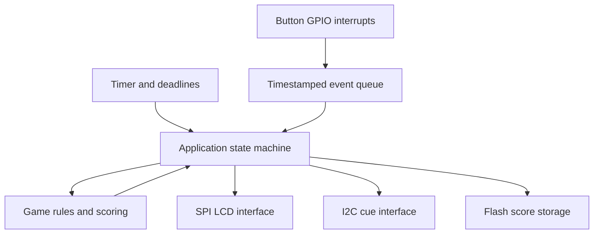
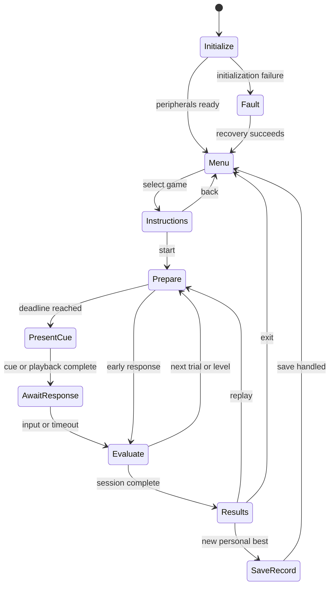

# STM32-Based Cognitive Training Console

**An interactive embedded game console exploring reaction timing, sequence memory, and event-driven firmware on the STM32.**

**Platform:** STM32 NUCLEO-L432KC  
**Interfaces:** GPIO · Hardware timers · SPI · I²C · SWD  
**Firmware focus:** Embedded C · Finite state machines · Interrupts · Internal Flash storage  
**Status:** Planning and prototyping. Specifications below are design targets, not measured capabilities.

## Overview

I am developing a handheld-style game console that challenges players to respond to visual cues, distinguish valid cues from distractions, and reproduce increasingly long sequences. The project uses the same STM32 development board and graphical LCD as my oscilloscope project, applying those hardware integration and display skills to an interactive, event-driven application.

My goal is to build a complete embedded system: define requirements, configure peripherals in STM32CubeMX, implement modular C firmware, connect physical controls, measure timing behavior, and preserve scores across power cycles. The emphasis is on understanding how user input, communication interfaces, timing, and application state interact.

The final deliverable is a **working Nucleo-based tabletop prototype** with three games, four illuminated response positions, an LCD menu, and persistent personal bests. “Cognitive training” describes the game theme; this project does not assess clinical cognitive function or claim demonstrated cognitive improvement.

## Demo and Project Evidence

| Item | Status |
| --- | --- |
| Complete prototype photograph | To be added after hardware integration |
| Gameplay video covering all three modes | Planned following functional validation |
| Menu and results-screen images | To be added during UI integration |
| SPI and I²C logic-analyzer captures | Planned during peripheral verification |
| Cue-to-button timing measurements | Pending bench validation |
| Power-cycle score-retention demonstration | Planned after Flash integration |

<!-- Add the prototype image here when available. -->
<!-- Add a gameplay video link here when available. -->

## What I Am Working On Hands-On

| Skill | Application in this project |
| --- | --- |
| Embedded C | Peripheral drivers, event structures, bounded buffers, game logic, and interfaces between modules |
| STM32CubeMX | Pin assignment, clocks, GPIO/EXTI, hardware timers, SPI, and I²C configuration |
| GPIO | Four response buttons, a navigation button, input biasing, and edge handling |
| Hardware timers | Timestamping responses, generating deadlines, scheduling cues, and handling counter rollover |
| SPI | Reusing or adapting the LCD driver for menus, prompts, and results |
| I²C | Configuring a GPIO expander, updating cue LEDs, and handling bus failures |
| Finite state machines | Explicit transitions between menus, preparation, gameplay, results, and faults |
| Interrupts and event handling | Capturing time-sensitive events while keeping interrupt work short |
| Internal Flash | Versioned records, integrity checks, bounded write frequency, and recovery from interrupted writes |
| Hardware debugging | SWD debugging and logic-analyzer verification of communication and timing |
| Validation | Repeatable tests for button bounce, response timestamps, game rules, and persistent storage |

This project extends the oscilloscope work through structured user interaction and persistent state. The display experience is reusable, while the game engine, input-event handling, and score-storage logic introduce new engineering problems.

## Game Modes

### 1. Reaction Time

Measure how quickly the player responds to a single visual cue.

1. Select **Reaction Time** and press the center button to begin.
2. Wait through a pseudorandom delay of **2–5 seconds** with all cue LEDs off.
3. When the LED above response button 1 illuminates, press button 1 as quickly as possible.
4. View the result and continue until **five attempts** are complete.

**Rules:**

- A response during the waiting period is a false start.
- A different response button after the cue is an incorrect response.
- No response within **2 seconds** is a timeout.
- A false start, incorrect response, or timeout consumes an attempt but is excluded from reaction-time statistics.
- The results screen shows valid attempts, fastest time, and mean valid response time.
- A persistent personal best is eligible only when all five attempts are valid; it uses the session mean so one unusually fast response does not determine the record.

### 2. Go / No-Go

Respond to one cue while withholding a response to another.

1. Complete **20 trials** with pseudorandom ordering: **14 Go** and **6 No-Go** trials.
2. On a **Go cue**—LED 1—press response button 1.
3. On a **No-Go cue**—LED 4—do not press a response button.

Each trial has a **1–3 second** preparation interval followed by a **1 second** response window. The LED position, rather than color alone, identifies the cue.

**Rules:**

- Go: button 1 within the window is correct; a different response or no response is incorrect.
- No-Go: no response through the window is correct; any response button is incorrect.
- Any response during the preparation interval marks that trial incorrect and ends it.
- Accuracy is correct trials divided by 20. Mean response time uses only correct Go responses.
- Personal best is ranked by accuracy, with lower mean correct-Go response time as the tie-breaker when available.

### 3. Sequence Memory

Watch an LED sequence and reproduce it using the four response buttons.

1. The console presents a sequence of **three positions**.
2. Each cue remains on for **500 ms**, followed by a **250 ms** gap.
3. After playback, enter the sequence using the corresponding buttons.
4. A correct sequence advances the game by appending one position.
5. A wrong entry or **5 seconds** without the next response ends the session.

The sequence is capped at **12 positions**. Completing all 12 displays a completion screen. The score is the longest fully completed sequence; a session ending before the first successful sequence scores zero. Input during playback is ignored, and buttons must be released before the entry phase begins.

## Controls and UI

Four response buttons are arranged in a row and labeled **1–4**, with one cue LED above each. A fifth **center button** handles starting, confirming, and exiting.

| Context | Controls |
| --- | --- |
| Main menu | Button 1: previous; button 4: next; center: select |
| Instructions screen | Center: start; hold center: return to menu |
| Reaction / Go-No-Go | Response buttons follow the rules above |
| Sequence entry | Buttons 1–4 reproduce the displayed positions |
| Results screen | Center: replay; button 4: main menu |
| Any active game | Hold center for **1 second** to abort without saving the session |
| Settings | View records or request a reset; deletion requires a confirmation screen |

The LCD provides instructions, trial/sequence progress, results, and fault messages. Timed reaction cues come from the LEDs, so a full LCD redraw is not used as the reaction-time reference. Abort handling takes priority over a simultaneous game response.

## Proposed Hardware

| Item | Quantity | Purpose |
| --- | --- | --- |
| STM32 NUCLEO-L432KC | 1 | Main controller and development/debug platform |
| Existing SPI graphical LCD | 1 | Menus, instructions, progress, and results |
| Momentary push buttons | 5 | Four responses and one navigation/start control |
| LEDs | 4 | Spatial game cues |
| LED current-limiting resistors | 4 | Set safe operating current |
| 3.3 V-compatible I²C GPIO expander module | 1 | Drive the four cue LEDs over I²C |
| I²C pull-ups, if not already fitted | As required | Establish valid bus high levels |
| Breadboard, jumpers, and supply decoupling | As required | Prototype interconnection |
| USB cable | 1 | Board power and development connection |

**Component selection pending:** The expander part, address, pull-ups, LED resistor values, LCD module variant, and final pin map will be recorded after electrical compatibility and pin availability are checked. The existing display/reference uses an ST75256-based module; the actual wired module configuration remains authoritative.

### Why Two Serial Interfaces?

- **SPI connects the LCD**, extending the display-driver work from the oscilloscope project.
- **I²C connects the LED expander**, providing practical experience with device addressing, register configuration, pull-ups, acknowledgements, and error handling.
- **Response buttons connect directly to MCU GPIO**, allowing their edges to be timestamped without polling an I²C input device.

This deliberately assigns the interfaces different jobs. It also introduces a useful timing question: how much delay exists between issuing a bus transaction and the physical LED becoming visible?

## Target Specifications

| Parameter | Design target |
| --- | --- |
| Game modes | Reaction Time, Go/No-Go, Sequence Memory |
| Physical inputs | Four response buttons plus one center button |
| Cue outputs | Four independently controlled LEDs |
| Response timer resolution | **1 µs timer tick**, subject to final clock configuration |
| Displayed response resolution | **1 ms** |
| End-to-end timing error | Target absolute error **≤2 ms**, verified against measured LED/button edges |
| Button qualification | Initial target **10 ms** stable confirmation; tuned using measured bounce |
| Interface responsiveness | Menu feedback within **100 ms** of a qualified input |
| LCD behavior | Event-driven updates; no full-screen redraw during a timed response window |
| Initial I²C clock | **100 kHz**, subject to selected-device support and measured bus behavior |
| SPI clock | Selected from LCD requirements and validated signal timing |
| Persistent data | Personal best for each game and record-format metadata |
| Flash write policy | Write only when a completed session improves a record, or on confirmed reset |
| Execution model | Bare-metal cooperative event loop with short interrupt handlers |
| Power | USB-powered development-board prototype |

Timer resolution is not the same as measurement accuracy. The error budget includes cue-update latency, interrupt latency, timestamp placement, and input processing. Specifications remain targets until supported by measurements.

## Firmware Architecture

### Event Handling and Timing

Interrupt handlers capture candidate button edges and timestamps, then return quickly. Debounce qualification runs outside the interrupt. If the input remains valid through the qualification interval, the accepted event retains the initial edge timestamp; qualification must not simply add its delay to the reported reaction time.

Each press requires release before another press can be accepted. Buttons held before a new round block the round from arming. Multiple response buttons pressed within one debounce qualification interval count as invalid in modes expecting one response.

The implementation will define safe access to shared data, a bounded event queue, and an explicit overflow path. Queue overflow invalidates the current session rather than silently reporting a potentially incorrect score. Time comparisons will account for timer rollover within the supported measurement intervals.

Cue timing will initially use a documented timestamp at I²C write completion. Because the LED can change before that software timestamp, logic-analyzer measurements will characterize the offset and variation. A validated compensation or revised timestamp strategy will be required if the uncorrected path misses the timing-error target. A failed cue transaction invalidates the trial.

### State Machine

This diagram shows the common lifecycle; each game defines its own preparation, cue, and evaluation rules. Abort and hardware faults are global transitions handled by the application. Flash saves finish before the next timed session begins.

### Planned C Modules

| Module | Responsibility |
| --- | --- |
| `app.c/.h` | Main state machine, dispatch, and global abort/fault handling |
| `buttons.c/.h` | Edge capture, debounce qualification, press/release events |
| `timebase.c/.h` | Timer timestamps and rollover-safe interval calculations |
| `event_queue.c/.h` | Bounded communication between interrupts and application logic |
| `lcd.c/.h` | Low-level SPI display interface |
| `ui.c/.h` | Menus, prompts, progress, and results rendering |
| `cue_io.c/.h` | I²C expander setup, LED control, and communication errors |
| `game_reaction.c/.h` | Reaction-game rules and statistics |
| `game_go_nogo.c/.h` | Trial scheduling, accuracy, and valid-response statistics |
| `game_sequence.c/.h` | Sequence generation, playback, and input comparison |
| `scores.c/.h` | Personal-best comparison and record representation |
| `flash_store.c/.h` | Record validation, append/rotation, and recovery |

The architecture avoids blocking delay loops during gameplay. Timer deadlines advance the state machine while the application continues servicing input and faults. Pseudorandom sequences will use a recorded algorithm and a user-timing-derived seed; a fixed seed will be available for repeatable tests. This randomness is for gameplay, not security.

## Persistent Scores in Internal Flash

Personal bests will survive normal power cycles without an external memory device. Storage design will be finalized against the MCU's actual erase/program geometry and available application memory.

The proposed record contains a magic identifier, format version, sequence number, game identifier, score fields, integrity check, and commit marker. The plan is to:

1. Reserve dedicated Flash storage in the linker configuration, separate from executable code.
2. Append new records rather than erase for every score update.
3. Commit a record only after its payload and integrity information are written.
4. Use two reserved erase units so an older valid record remains available during rotation.
5. Load the newest valid committed record at startup and ignore incomplete or invalid records.
6. Perform writes/erases outside timed gameplay and report save failures without presenting them as successful saves.

Flash endurance and programming constraints will be taken from the device documentation. Power-loss recovery is a feature to implement and test, not an assumed guarantee. A confirmed record reset will preserve the same recovery discipline. Firmware flashing may erase stored scores depending on programming settings; normal power-cycle retention and reprogramming behavior will be documented separately.

## Scope Boundaries

**Included:** Three fixed-rule games, local LCD UI, physical buttons and LED cues, SPI/I²C integration, timer-based response measurements, explicit game states, personal-best storage, and reproducible validation.

**Outside the first release:** Custom PCB fabrication, wireless connectivity, a mobile app, cloud accounts, multiple player profiles, touchscreen input, an RTOS, adaptive difficulty, and medical or cognitive-performance conclusions.

The prototype will be considered complete when all three games operate according to their rules, measured timing is reported, score retention and error handling are tested, and another person can reproduce the build from the documentation.

## Verification Plan

| Test | Acceptance criterion / evidence |
| --- | --- |
| Button bounce and holds | One accepted event per press; held inputs do not trigger new rounds |
| Reaction boundaries | False starts, wrong inputs, valid inputs, and timeouts classified correctly |
| Go/No-Go schedule | Exactly 14 Go and 6 No-Go trials per 20-trial session |
| Sequence logic | Known sequences accepted/rejected correctly; progression stops at 12 |
| Timing accuracy | Known electrical cue-to-response intervals compared with reported times; target error ≤2 ms |
| Timer rollover | Correct interval/deadline behavior across counter wrap |
| I²C / SPI | Decoded captures agree with intended configuration and transactions |
| Bus fault | Missing expander or failed transaction cancels scoring and produces a fault indication |
| Queue overload | Overflow is detected and the affected session is invalidated |
| Score persistence | Completed record survives reset and normal power removal |
| Interrupted save | Previous valid data or a documented empty/default state loads; incomplete data is rejected |
| Repeated sessions | No stuck states, unbounded queue growth, or unexpected score changes over 50 sessions |

Game logic will be tested with deterministic event sequences independently of physical button timing where practical. Hardware tests will record the firmware commit, setup, input conditions, expected result, observed result, and supporting capture.

### Measured Results

| Metric | Result |
| --- | --- |
| Timer configuration and verified tick period | Pending implementation |
| Cue timestamp offset and variation | Pending measurement |
| Maximum observed response-time error | Pending validation |
| Button bounce / chosen qualification interval | Pending characterization |
| Menu response latency | Pending measurement |
| Flash write/erase duration | Pending measurement |
| Power-cycle and interrupted-save results | Pending testing |

## Repository and Reproduction

The following folders are planned; their contents will be added as implementation progresses.

| Path | Contents |
| --- | --- |
| `firmware/` | CubeMX `.ioc`, C source, startup/linker files, and required dependencies |
| `hardware/` | Prototype schematic, exact pin map, and BOM |
| `docs/` | Architecture, protocol details, build guide, and engineering decisions |
| `tests/` | Game-logic tests, procedures, results, and analyzer captures |
| `media/` | Prototype photographs, UI images, and demo assets |

**Build and wiring guide: pending validation from a clean checkout.** The finished guide will specify the toolchain/version, board configuration, LCD variant, I²C device and address, pull-ups, pins, and Flash memory reservation. It will cover building, flashing, hardware checks, playing each game, and resetting records.

## Development Milestones

- [ ] Confirm pin availability, expander selection, and electrical compatibility.
- [ ] Bring up the SPI LCD, five buttons, and I²C cue LEDs.
- [ ] Implement timer timestamps, qualified input events, and the main state machine.
- [ ] Complete and validate Reaction Time.
- [ ] Add and validate Go/No-Go and Sequence Memory.
- [ ] Implement persistent records and test recovery behavior.
- [ ] Measure timing, interface responsiveness, and sustained operation.
- [ ] Publish wiring, build instructions, test evidence, and gameplay video.

## Reflection and Attribution

Design notes will document real implementation decisions and debugging cases: observed symptoms, hypotheses, measurements, root causes, corrections, and verification. Particular attention will go to the difference between a precise timer and an accurate end-to-end reaction measurement, and to preserving valid scores while handling Flash constraints.

The LCD driver may reuse or adapt work from my STM32 oscilloscope project. Any tutorial-derived or third-party code will retain its source attribution and license notices. Original application logic, generated STM32 support code, and adapted drivers will be identified separately.

**Reference documentation to be added:** NUCLEO-L432KC board documentation, STM32L432 datasheet/reference manual, LCD module/controller documentation, and the selected I²C expander datasheet, including the revisions used.
